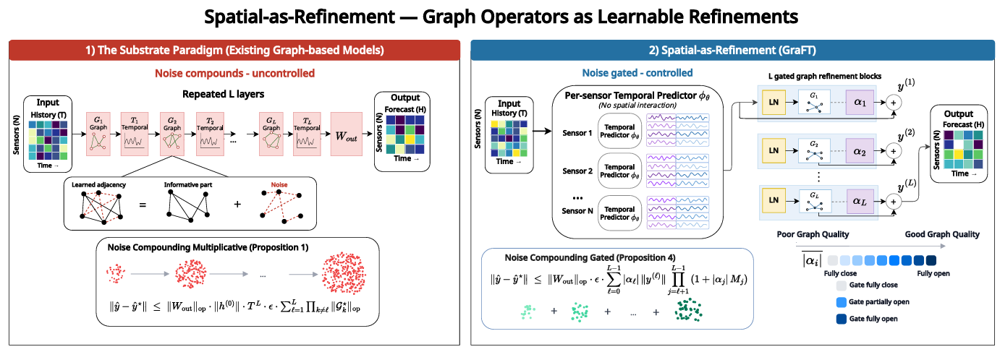
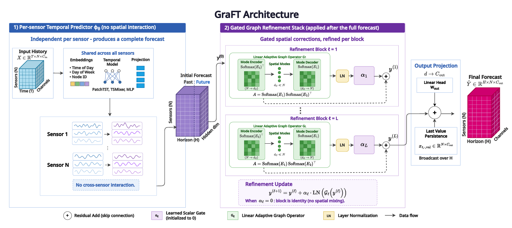
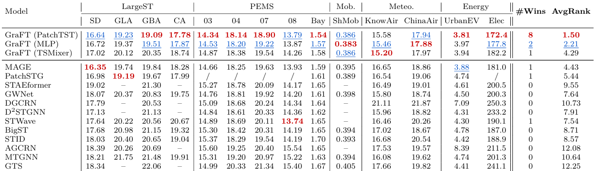

# [GraFT: Spatial-as-Refinement for Spatio-Temporal Forecasting](https://vpham47.github.io/files/Spatial_as_refinement_Preprint%20%281%29.pdf)

### A bridge between the temporal and spatio-temporal forecasting communities

Official implementation of *Spatial-as-Refinement: Gated Graph Operators over Strong Temporal Predictors for Scalable Spatio-Temporal Forecasting*.

<p align="center">
  
</p>

Graph-based forecasters put the graph inside every layer, so a noisy learned graph spreads its errors through the whole model. GraFT changes where the graph sits. A per-sensor temporal predictor first makes a complete forecast, and gated graph blocks then refine it: $y \leftarrow y + \alpha \cdot \mathrm{LN}(\mathcal{G}(y))$, with each $\alpha$ initialized at 0. GraFT needs no adjacency matrix and scales linearly in the number of sensors.

<p align="center">
  
</p>

<p align="center">
  
  <br><em>Test MAE on 14 benchmarks (mean of 5 seeds). Red: best; blue, underlined: second best.</em>
</p>

## Quickstart

```bash
pip install -r requirements.txt                       # tested with Python 3.11, PyTorch 2.5
python tools/make_synthetic.py --out data/synthetic   # tiny demo dataset
python run.py --backbone patchtst --data data/synthetic
```

Results (MAE, RMSE, MAPE, learned gates) go to `experiments/<dataset>/graft_<backbone>/`. `python tests/smoke_test.py --quick` checks the install.

## Your own data

One CSV row per time step, one column per sensor, with an optional timestamp in the first column:

```bash
python tools/csv_to_graft.py --csv my_city.csv --out data/my_city   # add --no_timestamp --steps_per_day 288 if there are no timestamps
python run.py --backbone patchtst --data data/my_city              # hyperparameters chosen from the number of sensors
```

## Backbones

| | Backbones | Notes |
|---|---|---|
| **Main** (paper) | `patchtst`, `mlp`, `tsmixer` | PatchTST is the best overall; MLP is the lightest; TSMixer converges fastest |
| **Additional** | `dlinear`, `timemixer`, `timesnet`, `itransformer`, `autoformer`, `segrnn`, `olinear` | Not evaluated in the paper; untuned defaults |

The additional backbones come from [Time-Series-Library](https://github.com/thuml/Time-Series-Library) (MIT). OLinear is our re-implementation from its paper. To add your own, write a predictor mapping `[B·N, T, C]` to `[B·N, horizon, d]` (see `graft/backbones/main/mlp.py`) and register it in `graft/registry.py`.

## Hyperparameters by dataset size

With `--data` the preset is picked from the number of sensors N (`--preset auto`); force one with `--preset small|medium|large`. The values are distilled from the 42 paper runs in `configs/paper_configs.json`.

| | Small (N < 500) | Medium (500–2,500) | Large (N > 2,500) |
|---|---|---|---|
| Refinement layers `graft_num_layers` | 3 | 3 | 1 |
| Graph modes `graft_graph_dG` | 64 | 128 | 128 |
| Batch size `bs` | 16 | 16 | 16 (lower if out of memory) |
| Learning rate `lrate` | 2e-3 | 1e-3 | 2e-3 |

- Override any setting on the command line, for example `--graft_num_layers 2 --lrate 0.001`; all settings are in `graft/config.py`.
- The log reports the learned gates |α|. A mean gate near 0 means the graph is not helping on your data, and GraFT has fallen back to its temporal backbone.

## Reproduce the paper

Get the data from its original sources:
- [LargeST](https://github.com/liuxu77/LargeST) for SD, GBA, GLA and CA;
- [BasicTS](https://github.com/GestaltCogTeam/BasicTS) for PEMS03/04/07/08;
- [DCRNN](https://github.com/liyaguang/DCRNN) for PEMS-Bay;
- [UrbanEV](https://github.com/IntelligentSystemsLab/ST-EVCDP);
- [Electricity](https://github.com/decisionintelligence/TFB);
- [KnowAir](https://github.com/shuowang-ai/PM2.5-GNN);
- [China Air Quality](https://github.com/Friger/GAGNN);
- [Shanghai Mobile](https://drive.google.com/file/d/1TWD3QDBrsn90zxbDom94BF4fR-NOp0Pi/view).

The expected folder layout is in `graft/datasets.py`. With `--dataset`, the paper settings are used:

```bash
python run.py --backbone patchtst --dataset sd     # sd gba gla ca pems03 pems04 pems07 pems08 bay urbanev ele sh knowair ccaq
```

The paper reports the mean of 5 seeds (`--seed`).

## Citation

```bibtex
@article{graft2026,
  title  = {Spatial-as-Refinement: Gated Graph Operators over Strong Temporal Predictors for Scalable Spatio-Temporal Forecasting},
  author = {AUTHORS},
  year   = {2026}
}
```

Questions: open an issue or email vpham47@gatech.edu. The training engine and data pipeline build on [LargeST](https://github.com/liuxu77/LargeST) and [MAGE](https://github.com/PoorOtterBob/MAGE) (both MIT).
